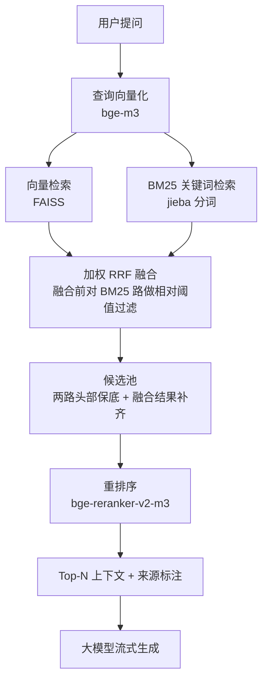

# RAG 多源知识库问答系统

把 PDF / Word / Excel / SQLite 四类异构数据统一入库，用「向量检索 + 关键词检索 → 加权 RRF 融合 → 重排序」的多阶段检索找出相关原文，让大模型**只依据检索到的内容**作答，并在回答中标注来源编号。

## 解决什么问题

企业和机构的制度、法规类文档通常散落在 PDF、Excel 和业务数据库里。人工查慢，直接问大模型又会编造。

本项目的做法是：先从知识库检索出相关原文，再让模型基于这些原文回答，并给出可追溯的出处。资料不足时，模型会明确回答「知识库中未找到相关内容」，而不是硬编一个答案。

## 检索架构



**为什么做混合检索：** 单靠向量检索，会漏掉「第 27 条」这类精确表述；单靠 BM25，又理解不了同义改写。两路互补，再用 RRF 融合。

## 技术栈

Python · FastAPI · FAISS · BM25(rank_bm25 + jieba) · bge-m3 嵌入 · bge-reranker-v2-m3 重排序 · DeepSeek API / Ollama 本地模型

## 目录结构

```
.
├── main.py               FastAPI 入口，提供上传 / 检索 / 流式问答接口
├── pipeline.py           入库流程 + 四阶段检索 + 生成
├── models_api.py         嵌入 / 重排 / LLM 调用，含重试与降级
├── stores.py             SQLite 存储 + FAISS 向量索引 + BM25 索引
├── parsers.py            四类数据源解析与分块
├── eval_retrieval.py     检索效果评测（四方案对比）
├── make_sample_data.py   生成演示用示例数据
├── config.example.py     配置模板
├── web/index.html        前端界面（检索过程可视化）
└── data/
    ├── sample/           示例知识库（法规节选、Excel、SQLite）
    └── eval/             评测集与评测结果
```

## 快速开始

```bash
pip install -r requirements.txt

cp config.example.py config.py      # 填入自己的 Key；不填也能跑，会自动降级

python main.py                      # 启动后访问 http://127.0.0.1:8000
```

在网页里上传文件或导入示例数据库 → 点「重建索引」→ 开始提问。

## 评测

**方法**：人工标注 30 道问题（覆盖文档 / 表格 / 数据库三类数据源），每题标注能回答该问题的片段 ID，
对比四种检索方案的 **Recall@1 / Recall@5 / MRR**。评测脚本与数据集均在仓库内，可复现。

| 检索方案 | Recall@1 | Recall@5 | MRR |
|---|---|---|---|
| 方案一：仅向量检索 | 86.7% | 100.0% | 0.922 |
| 方案二：仅 BM25 检索 | 80.0% | 100.0% | 0.875 |
| 方案三：向量 + BM25 融合 | 83.3% | 100.0% | 0.906 |
| **方案四：融合 + 重排序** | **93.3%** | **100.0%** | **0.967** |

## 三个值得说的发现

**① Recall@5 全部 100%，说明这个指标在本语料上没有区分度。**
30 道题、片段规模不大的情况下，Top-5 几乎必然覆盖正确答案。真正能区分方案优劣的是 Recall@1 和 MRR。
这也是为什么评测重点看 MRR——它同时考虑命中与否和排名位置。

**② 单纯融合（83.3%）反而比纯向量（86.7%）低 3.4 个百分点。**
这个结果反直觉，但很说明问题：固定权重的 RRF 并不总是带来增益，当 BM25 路的质量不如向量路时，
融合会把噪声注入排序。而加上重排序之后（93.3%），融合带来的召回覆盖才被转化成排序质量。

> 结论：**融合解决的是"召回覆盖面"，重排序解决的是"排序质量"，两者不能互相替代。**
> 只看 Recall@5（都是 100%）会得出"融合没用"的错误结论。

**③ 耗时几乎全部来自外部 API，本地检索可以忽略。**

| 阶段 | 平均耗时 | 最大耗时 |
|---|---|---|
| 查询向量化 | 1108.8 ms | 1769.7 ms |
| 向量检索（FAISS） | 0.3 ms | 0.3 ms |
| BM25 检索 | 1.4 ms | 2.8 ms |
| RRF 融合 | 0.0 ms | 0.1 ms |
| 重排序 | 1434.2 ms | 1990.3 ms |

本地检索合计不到 2ms，占总耗时不到 0.1%。**优化本地算法没有意义，性能优化必须做在 API 侧**
（批量、缓存、并发、超时降级）。

## 我负责的部分

- **需求与场景定义**：确定面向校园知识库的问答场景、数据源范围与验收标准
- **方案设计**：确定「混合检索 + 加权 RRF 融合 + 重排序」的整体链路，以及各阶段参数
- **评测体系**：设计四方案对比实验，完成评测集标注，定义 Recall@K / MRR 计算口径
- **结果分析**：定位融合方案的负增益原因，确认性能瓶颈在 API 而非本地检索
- **实现与验证**：完成系统开发与联调，负责参数调整与结果验证

## 工程细节：全链路降级

系统对三个外部依赖都做了降级处理，任何一个挂掉都不会导致整体不可用：

| 依赖 | 失败时 |
|---|---|
| 嵌入接口 | 降级为字符二元组哈希向量（仅界面演示，评测禁用） |
| 重排序接口 | 回退为融合排序结果 |
| 大模型接口 | 回退为「知识库原文摘录 + 来源标注」 |

外加统一的请求重试与指数退避。

## 已知限制

- 评测集为 30 题，规模偏小，Recall@5 已饱和；扩到 300+ 片段、100+ 题后结论可能变化
- 分块策略为固定长度切分，未做语义分块，长表格跨行时可能切断
- 索引为全量重建，数据量大时重建耗时明显，尚未做增量更新
- 未做多轮对话的指代消解，追问需要重复上下文
